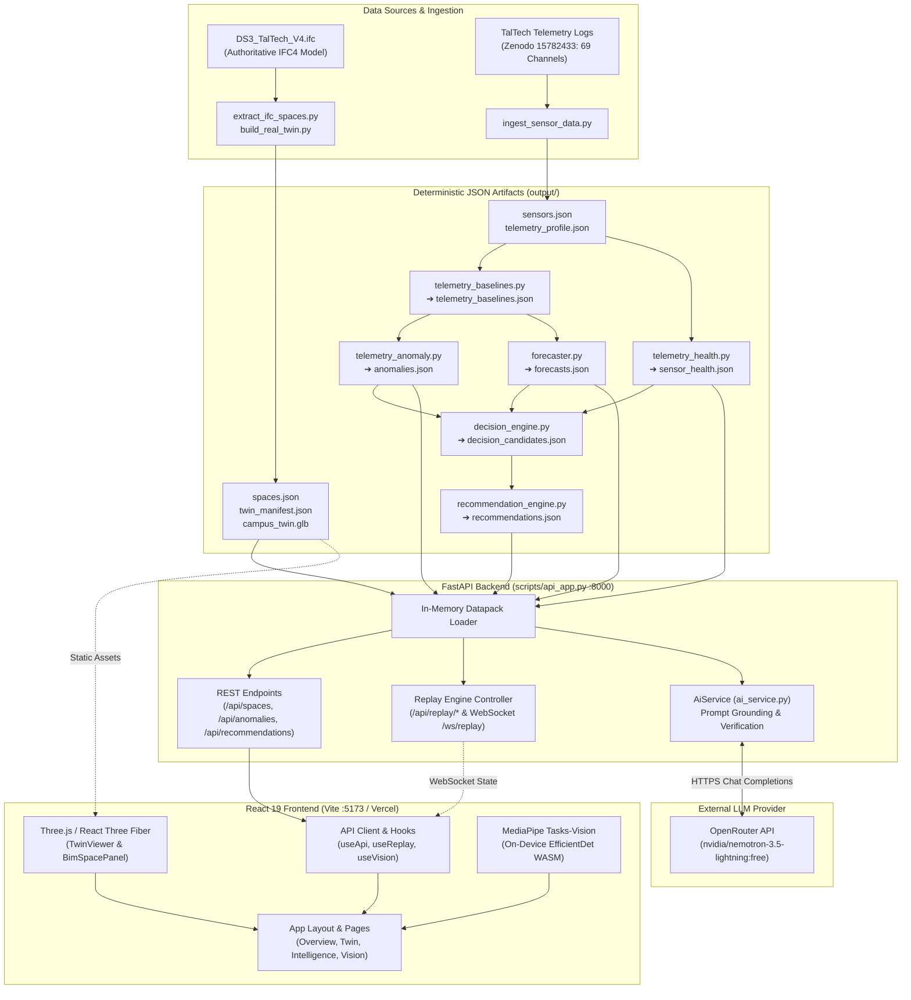

# Green Twin — Sustainable Building Intelligence

**From building data to better decisions.**

Green Twin is a sustainable building intelligence platform developed for the **DSU CodeClash 2.0 (Eureka)** hackathon addressing **Problem Statement 04: Green Building Digital Twin (PS 04)**. It bridges the gap between static architectural BIM models and dynamic building operations by joining ~1.39 million real telemetry readings from the TalTech **DS3 – Ehituse Mäemaja** building with an authoritative IFC4 3D building model. 

The platform normalizes raw telemetry, establishes time-aware operational baselines, detects anomalies, evaluates continuous sensor health, surfaces on-device camera occupancy estimates, and generates explainable, audit-trailed sustainability recommendations alongside issue-scoped generative AI diagnostics.

---

## 🚀 Live Deployments

| Resource | URL | Status / Description |
| :--- | :--- | :--- |
| **Live Web Application** | [https://dsu-code-clash-2-0-eureka.vercel.app/](https://dsu-code-clash-2-0-eureka.vercel.app/) | Production React 19 SPA deployed on Vercel |
| **Decision Engine API** | [https://dsu-codeclash-2-0-eureka.onrender.com](https://dsu-codeclash-2-0-eureka.onrender.com/) | FastAPI backend web service deployed on Render |
| **Interactive Swagger Docs** | [https://dsu-codeclash-2-0-eureka.onrender.com/docs](https://dsu-codeclash-2-0-eureka.onrender.com/docs) | Live OpenAPI / Swagger UI interactive documentation |
| **API Health Check** | [https://dsu-codeclash-2-0-eureka.onrender.com/api/health](https://dsu-codeclash-2-0-eureka.onrender.com/api/health) | Service availability and sensor health summary |

> **Production Note:** The frontend is hosted on Vercel and configured to communicate directly with the Render-hosted FastAPI service via CORS-enabled REST endpoints. No simulated savings or fake physical sensor coordinates are injected into the production interface.

---

## Table of Contents

- [Overview](#overview)
- [Problem Statement — Green Building Digital Twin (PS 04)](#problem-statement--green-building-digital-twin-ps-04)
- [Key Features](#key-features)
- [System Architecture](#system-architecture)
- [Technology Stack](#technology-stack)
- [BIM and Digital Twin](#bim-and-digital-twin)
- [Historical Telemetry and Analytics Pipeline](#historical-telemetry-and-analytics-pipeline)
- [Generative AI Integration](#generative-ai-integration)
- [Computer Vision and Occupancy Observations](#computer-vision-and-occupancy-observations)
- [API Overview](#api-overview)
- [Repository Structure](#repository-structure)
- [Local Installation and Setup](#local-installation-and-setup)
- [Environment Variables](#environment-variables)
- [Running Frontend and Backend](#running-frontend-and-backend)
- [Testing and Validation](#testing-and-validation)
- [Deployment Configuration](#deployment-configuration)
- [Data Provenance and Limitations](#data-provenance-and-limitations)
- [Team Contributions](#team-contributions)
- [Future Scope](#future-scope)
- [License](#license)

---

## Overview

Facility managers and building engineers frequently operate with fragmented information: Building Information Modeling (BIM) files describe nominal design specifications, while Building Management Systems (BMS) and IoT loggers quietly accumulate gigabytes of time-series records without contextual interpretation.

Green Twin establishes an end-to-end data pipeline:
```
OBSERVE ─────────▶ DETECT ─────────▶ UNDERSTAND ─────────▶ RECOMMEND
69 telemetry       Z-score &        Historical hourly      Deterministic,
sensor channels    statistical      baselines per          explainable
(1.39M points)     deviations       channel                action candidates
```

Every number in the application is traceable back to immutable data artifacts generated from the TalTech university building dataset and IFC4 building geometry.

---

## Problem Statement — Green Building Digital Twin (PS 04)

Modern commercial and educational facilities consume massive amounts of energy and represent significant operational overhead. In practice, building intelligence remains hindered by four critical problems:

1. **Telemetry is Orphaned:** Environmental and energy monitoring streams exist as flat CSV logs or isolated databases. Facilities teams rarely possess automated tools to synthesize raw streams into proactive operations.
2. **BIM is a Static Archive:** Architectural IFC models document nominal design intent (envelope area, volume, design occupant limits, specified lighting and HVAC loads) but are never evaluated against operational telemetry.
3. **Alerts Lack Explainability:** Standard BMS software issues binary alarms when static thresholds trip, failing to communicate baseline variance, persistence, or data reliability.
4. **Occupancy and Scheduling Guesswork:** Space allocation and ventilation modulation are governed by rigid static schedules rather than actual room occupancy dynamics.

### How Green Twin Addresses PS 04

- **Synthesizes Geometry with Operations:** Parses true IFC4 architectural geometry (`DS3_TalTech_V4.ifc`) and overlays operational metrics.
- **Auditable Anomaly Detection:** Compares signals against hour-of-week baselines, quantifying deviation severity rather than relying on arbitrary static cutoffs.
- **Transparent Decision Engine:** Uses a multi-factor ranking algorithm with complete evidence traceability from raw reading to actionable recommendation.
- **Edge Vision Sensing:** Incorporates local, client-side computer vision for non-invasive occupancy observations without transmitting privacy-sensitive video feeds.
- **Grounded LLM Diagnostics:** Employs an issue-scoped AI assistant grounded strictly on pre-computed finding summaries to diagnose anomalies without hallucinations.

---

## Key Features

| Route | View / Component | Core Capabilities |
| :--- | :--- | :--- |
| `/` | **Building Performance Overview** | Executive summary dashboard featuring real-time building pulse (environment, power, sensor health), telemetry status strip, critical anomaly tallies, featured top recommendation, and embedded 3D twin viewport. |
| `/twin`<br>`/digital-twin` | **3D Digital Twin Viewer** | Interactive Three.js/R3F model of the 5-storey TalTech building. Features floor-by-floor filtering, camera perspective presets (Perspective, Top View, Fit), room search directory, and a **BIM Space Panel** displaying area, volume, height, design capacity, conditioning type, and engineering design loads. |
| `/intelligence` | **Sustainability Insights** | Diagnostic center providing anomaly inspection with multi-parameter filtering, continuous sensor health tracking, multi-horizon forecasts (1h, 6h, 24h), and the deterministic 98-recommendation prioritization list. |
| `/intelligence` (finding detail) | **Finding Detail & Audit Chain** | Complete Evidence Traceability Chain (measurement → baseline → deviation → anomaly candidate → final recommendation) and Technical Diagnostics metadata. Embeds an issue-scoped AI diagnostic panel. |
| `/vision` | **Occupancy Monitoring** | Real-time, browser-based person detection powered by MediaPipe and EfficientDet-Lite0 via WebAssembly. Features explicit operator-configured **Demo Mapping**, privacy-preserving client-side execution, and telemetry correlation. |
| Header Bar | **Telemetry Replay Controller** | Interactive simulation bar offering playback controls (Start, Pause, Reset), speed multipliers ($1\times, 5\times, 10\times, 50\times$), simulated timestamp indicators, and WebSocket connectivity. |

---

## System Architecture



### Architecture Highlights
- **Artifact-Driven Reliability:** The backend does not depend on a bulky database engine. Each analytics phase reads and produces versioned, inspectable JSON files under `output/`. The FastAPI service loads these artifacts into memory on startup.
- **Strict Decoupling:** The browser talks only to documented REST/WebSocket endpoints. Secrets like `OPENROUTER_API_KEY` reside exclusively in the backend runtime environment.
- **Edge Computer Vision:** Video processing occurs strictly within the client browser via WebAssembly. No camera streams are transmitted to the backend.

---

## Technology Stack

### Frontend Application
- **Framework & Core:** React 19 (`19.2.8`), TypeScript (`~6.0.2`), Vite 8 (`8.3.0`)
- **Routing:** React Router v7 (`7.18.4`)
- **3D Graphics & Spatial Rendering:** Three.js (`0.186.1`), React Three Fiber (`@react-three/fiber` `9.8.0`), Drei (`@react-three/drei` `10.7.8`)
- **Computer Vision:** Google MediaPipe Tasks-Vision (`0.10.17`), TensorFlow Lite INT8 quantized models
- **Styling:** Custom CSS design system with CSS custom properties (`index.css`), Google Fonts (*Inter* and *JetBrains Mono*)
- **Code Quality & Testing:** Vitest (`5.0.1`), Testing Library (React, Jest-DOM, User-Event), Oxlint (`1.81.0`)

### Backend & Decision Services
- **Framework & Server:** FastAPI, Uvicorn (ASGI)
- **Data Validation & Serialization:** Pydantic v2
- **Numeric & Analytical Processing:** NumPy
- **HTTP Client (AI Integration):** HTTPX (asynchronous transport with timeouts and deadline enforcement)
- **Test Suite:** Pytest, Starlette TestClient

### BIM & Data Processing
- **BIM Parsing:** IfcOpenShell (IFC4 schema extraction)
- **3D Asset Formats:** glTF 2.0 Binary (`.glb`) with structured manifest JSON (`twin_manifest.json`)
- **Telemetry Ingestion:** Python standard library (csv, json, math, hashlib, zipfile)

---

## BIM and Digital Twin

The digital twin is derived from the official building design model **`DS3_TalTech_V4.ifc`** representing the **Ehituse Mäemaja** building at Tallinn University of Technology (TalTech).

### Spatial & Geometric Profile
- **Physical Envelope:** Depth: $44.6\,\text{m}$, Width: $51.8\,\text{m}$, Height: $22.2\,\text{m}$
- **Hierarchy:** 1 Campus, 1 Building, 5 Storeys (`Storey 0` through `Storey 4`), 115 Spaces
- **Extracted Structural Geometry:** 399 walls, 60 slabs, 102 columns, 116 doors, 190 windows and mullions, 26 stairs, 11 roofs, and 115 boundary volumes
- **Published Artifacts:**
  - `frontend/public/models/campus_twin.glb` — Optimized 3D architectural mesh
  - `frontend/public/models/twin_manifest.json` — 115 spaces with bounded dimensions, volume, floor association, and GlobalId attributes

### Space Inspector & Design Data
When a room is selected in the 3D viewer or space directory, the **BIM Space Panel** exposes engineering design parameters extracted directly from the IFC model:
- **Spatial Metrics:** Room Area ($m^2$), Volume ($m^3$), Ceiling Height ($m$)
- **Design Occupancy:** Nominal occupant capacity and conditioning classification
- **Electrical & Lighting:** Specified Lighting Load ($W$ and $W/m^2$), Power Design Load ($W$ and $W/m^2$), Average Estimated Illumination ($lx$)
- **HVAC Specifications:** Design Cooling Load ($W$), Design Heating Load ($W$), Air Changes per Hour ($ACH$), Area per Person ($m^2/\text{person}$)

> **Integrity Rule:** The UI clearly marks all space properties as **BIM Design Specifications** and explicitly clarifies that they represent architectural design targets, not measured real-time telemetry.

---

## Historical Telemetry and Analytics Pipeline

The analytics engine processes historical data collected from 36 monitoring devices across the TalTech facility between March 18, 2024 and June 30, 2025.

### Dataset Composition
- **Total Historical Readings:** 1,390,297 data points
- **Total Channels:** 69 measurement channels across 36 devices
  - Temperature: 29 channels
  - Relative Humidity: 26 channels
  - Carbon Dioxide ($CO_2$): 7 channels
  - Energy Consumption: 4 channels
  - Particulate Matter ($PM_{2.5}$): 3 channels
- **Data Quality Audit:**
  - `VALID`: 1,390,297 readings
  - `TIME_GAP`: 65,777 temporal gaps identified
  - `SUSPECT`: 2,890 values flagged for range or rate-of-change anomalies
  - `DUPLICATE`: 0 duplicates

### Analytics Pipeline Modules (`scripts/`)
1. **Ingestion & Validation (`ingest_sensor_data.py`):** Parses raw logs, validates ISO 8601 timestamps, checks measurement bounds, and tags quality flags.
2. **Time-Aware Baselines (`telemetry_baseline.py`):** Calculates hourly expected values and normal deviation ranges for every channel across 24-hour cycles.
3. **Statistical Anomaly Detection (`telemetry_anomaly.py`):** Uses z-scores and Median Absolute Deviation (MAD) against baselines. Recorded 15,937 detailed anomalies (3,168 Critical, 1,493 High, 3,486 Medium, 7,790 Low).
4. **Sensor Health Tracking (`telemetry_health.py`):** Detects frozen sensors (constant values), irregular sampling intervals ($CV \ge 0.25$), and long communication dropouts.
5. **Multi-Horizon Forecaster (`forecaster.py`):** Computes 1-hour, 6-hour, and 24-hour projected values using seasonal time-aware blending and documents coverage confidence.
6. **Decision & Recommendation Engine (`decision_engine.py` & `recommendation_engine.py`):** Evaluates anomaly persistence, severity, and forecast trends to synthesize 98 prioritized action candidates (55 High, 36 Medium, 7 Low).

---

## Generative AI Integration

Green Twin features an issue-scoped AI assistant designed for contextual diagnostic analysis. It avoids open-ended, generic chatbot interactions by anchoring analysis directly to verified finding records.

- **Provider & Model:** OpenRouter API (`nvidia/nemotron-3.5-lightning:free` by default, customizable via environment variables).
- **Backend-Only Security:** `OPENROUTER_API_KEY` is loaded and held exclusively by the backend service. It is never transmitted to the browser or logged.
- **Embedded Finding Workflow:** Selecting an anomaly or recommendation in the UI triggers `/api/ai/finding`. The backend compiles finding metadata, baseline bounds, sensor health, and interval statistics into an authoritative grounding context.
- **Honest Provenance & Claim Guards:**
  - Likely root causes distinguish `Hypothesis — to verify` from confirmed facts.
  - Every piece of supporting evidence includes explicit provenance tags (`Verified sensor`, `Webcam estimate`, `Historical replay`, `IFC design spec`, `Rule-based`).
  - Strict guardrails reject unverified energy or monetary savings claims, classifying unsupported figures as `Unknown — not verified`.
  - The model cannot alter room statuses, modify building parameters, or actuate physical systems.
- **Graceful Degradation:** If the API key is not configured, rate limits are reached, or network timeouts occur, the UI displays a clear status message and maintains full functionality of all deterministic tools.

---

## Computer Vision and Occupancy Observations

The occupancy module (`/vision`) introduces computer vision observations to the digital twin while preserving strict privacy and methodological honesty.

- **On-Device Inference:** Uses Google MediaPipe Tasks-Vision with an EfficientDet-Lite0 quantized INT8 model (`efficientdet_lite0_int8.tflite`). All inference runs locally in the browser via WebAssembly.
- **Zero Video Streaming:** Camera frames are evaluated in memory and discarded immediately. No video feeds or images are ever transmitted to any server.
- **Explicit Demo Mapping:** Because camera streams in a hackathon setting originate from the operator's local webcam, the platform does not pretend that the camera is a permanent physical sensor installed in an IFC room. Instead, operators can select a **Demo Mapping** to link the observation to an IFC space for evaluation purposes.
- **Observation Semantics:** Detections are labeled as visual estimates, not infallible physical occupant counts.

---

## API Overview

The backend is served by FastAPI on port 8000 (proxied via `/api` in local dev and Vercel production).

Interactive documentation is live at:
[https://dsu-codeclash-2-0-eureka.onrender.com/docs](https://dsu-codeclash-2-0-eureka.onrender.com/docs)

### Endpoint Catalog

| Method | Path | Description |
| :--- | :--- | :--- |
| `GET` | `/` | API root metadata and discovery catalog |
| `GET` | `/api/health` | Service status, device count, and sensor health summary |
| `GET` | `/api/campus` | Campus hierarchy, buildings, and storey list |
| `GET` | `/api/spaces` | Paginated spaces with storey, occupancy, and capacity filtering |
| `GET` | `/api/spaces/{space_id}/bim-design` | Read-only IFC architectural design loads for a single room |
| `GET` | `/api/resources` | Building resource aggregates (total area, volume, design capacity) |
| `GET` | `/api/telemetry/summary` | Telemetry channels summary, reading counts, and anomaly metrics |
| `GET` | `/api/anomalies` | Paginated anomaly events filterable by severity, sensor ID, and type |
| `GET` | `/api/forecasts` | Paginated forecast records (1h, 6h, 24h horizons) |
| `GET` | `/api/recommendations` | Paginated recommendations filterable by priority and category |
| `GET` | `/api/recommendations/{id}` | Full detail for a single recommendation including evidence chain |
| `GET` | `/api/decision-candidates` | Auditable decision candidates produced by the decision engine |
| `GET` | `/api/dashboard/summary` | Overview dashboard aggregate metrics |
| `GET` | `/api/ai/status` | Non-sensitive AI configuration status (configured, model name) |
| `POST` | `/api/ai/assistant` | General grounded questions scoped to building context |
| `POST` | `/api/ai/finding` | Grounded AI diagnosis and follow-up Q&A for an individual finding |
| `POST` | `/api/ai/room` | Room-scoped AI analysis using BIM attributes and camera observations |
| `POST` | `/api/ai/explain-status` | Explain deterministic room status rules |
| `POST` | `/api/ai/recommendations` | Grounded sustainability recommendations |
| `GET` | `/api/replay/status` | Current telemetry replay simulation state |
| `POST` | `/api/replay/start` | Start historical telemetry playback |
| `POST` | `/api/replay/pause` | Pause historical telemetry playback |
| `POST` | `/api/replay/reset` | Reset historical telemetry playback to initial timestamp |
| `POST` | `/api/replay/speed` | Set playback multiplier speed |
| `GET` | `/api/replay/current` | Current simulated sensor readings across all active channels |
| `GET` | `/api/replay/history` | Rolling historical window for a specific sensor channel |
| `WS` | `/ws/replay` | WebSocket streaming simulated telemetry updates at 800ms intervals |

---

## Repository Structure

```
DSU_CodeClash_2.0_Eureka/
├── DS3_TalTech_V4.ifc        # Authoritative IFC4 building model
├── CONTRIBUTOR_GUIDE.md      # Team package guide and role documentation
├── MANIFEST.json             # Manifest and file checksums
├── README.md                 # Primary project documentation
├── requirements.txt          # Python backend dependencies
├── .env.example              # Template for environment configuration
│
├── scripts/                  # Backend decision engine and pipeline
│   ├── api_app.py            # FastAPI application with CORS and WebSocket
│   ├── ai_service.py         # Grounded AI diagnostic service
│   ├── ai_openrouter.py      # Resilient OpenRouter Chat Completions client
│   ├── ai_config.py          # Environment loader (secrets never leaked)
│   ├── ai_schemas.py         # Pydantic models and claim guardrails
│   ├── building_context.py   # Grounding context builder
│   ├── room_status.py        # Deterministic room status evaluation rules
│   ├── replay_engine.py      # Telemetry replay controller
│   ├── ingest_sensor_data.py # Raw telemetry ingestion & validation
│   ├── telemetry_baseline.py # Time-aware baseline modeler
│   ├── telemetry_anomaly.py  # Statistical anomaly detection
│   ├── telemetry_health.py   # Sensor health tracking
│   ├── forecaster.py         # Multi-horizon trend forecasting
│   ├── decision_engine.py    # Multi-factor decision candidate ranker
│   ├── recommendation_engine.py # Rule-based recommendation engine
│   ├── extract_ifc_spaces.py # IFC space boundary and property extractor
│   └── build_real_twin.py    # Generates 3D glTF/GLB models from IFC
│
├── output/                   # In-memory data artifacts (versioned JSON)
│   ├── campus_registry.json  # Storey and building metadata
│   ├── spaces.json           # 115 spaces with IFC engineering properties
│   ├── resource_state.json   # Capacity and area aggregates
│   ├── sensors.json          # 36 physical monitoring devices
│   ├── sensor_health.json    # Reliability scores, freeze and gap records
│   ├── anomalies.json        # 15,937 flagged statistical deviations
│   ├── forecasts.json        # 1h, 6h, 24h predictive values
│   ├── decision_candidates.json # 98 prioritized action candidates
│   └── recommendations.json  # 98 fully formed recommendations
│
├── frontend/                 # React 19 + TypeScript + Vite SPA
│   ├── index.html            # Web app entry point
│   ├── package.json          # Frontend dependencies and scripts
│   ├── vite.config.ts        # Vite config with /api proxy & Vitest setup
│   ├── vercel.json           # Vercel deployment SPA rewrites
│   ├── src/
│   │   ├── App.tsx           # Route layout and navigation shell
│   │   ├── index.css         # Custom design system with CSS custom properties
│   │   ├── pages/            # Overview, DigitalTwin, Intelligence, Vision
│   │   ├── components/       # TwinViewer, BimSpacePanel, ReplayBar, layout
│   │   ├── ai/               # FindingAnalysis, RoomAnalysis, RecommendationList
│   │   ├── vision/           # VisionProvider, camera source, demo mapping
│   │   ├── api/              # Strongly typed API client and interfaces
│   │   └── lib/              # Formatting, room status rules, anomaly helpers
│   └── public/
│       ├── models/           # campus_twin.glb and twin_manifest.json
│       └── vision/           # MediaPipe WASM and EfficientDet TFLite model
│
├── docs/                     # Engineering documentation and technical specs
│   ├── AI_INTEGRATION.md     # Detailed AI architecture and grounding spec
│   ├── CV1_CAMERA_OCCUPANCY.md # Computer vision architecture
│   ├── CV2_ROOM_OCCUPANCY_TELEMETRY.md # Occupancy-telemetry linking
│   ├── SENSOR_IFC_MAPPING_REPORT.md # Sensor spatial mapping research
│   └── CAMPUSIQ_PRESENTATION.md # Pitch presentation guide
│
└── tests/                    # Backend Pytest test suite (11 test files)
    ├── test_ai_service.py    # AI client, error states, and claim guards
    ├── test_ai_finding.py    # Issue-scoped diagnostic finding tests
    ├── test_ai_room.py       # Room analysis AI tests
    ├── test_decision_intelligence.py # Decision ranking validation
    ├── test_recommendation_engine.py # Recommendation output tests
    └── test_replay_engine.py # Replay simulation tests
```

---

## Local Installation and Setup

### Prerequisites
- **Python:** 3.10, 3.11, or 3.12
- **Node.js:** 20.x or higher
- **npm:** 10.x or higher

### 1. Clone the Repository
```bash
git clone https://github.com/Rakshith-G-M/DSU_CodeClash_2.0_Eureka.git
cd DSU_CodeClash_2.0_Eureka
```

### 2. Backend Setup
Create and activate a Python virtual environment, then install dependencies:
```bash
python3 -m venv .venv
source .venv/bin/activate    # On Windows: .venv\Scripts\activate
pip install -r requirements.txt
```

### 3. Frontend Setup
Install frontend dependencies using npm:
```bash
cd frontend
npm install
cd ..
```

---

## Environment Variables

The project separates client-safe parameters from backend secrets.

### Backend Configuration
Create a `.env` file in the repository root by copying the template:
```bash
cp .env.example .env
```

Configure the following variables in `.env`:

| Variable | Default Value | Description |
| :--- | :--- | :--- |
| `OPENROUTER_API_KEY` | *(empty)* | Optional. OpenRouter API key for LLM analysis. If omitted, the app runs normally and AI degrades gracefully. |
| `OPENROUTER_MODEL` | `nvidia/nemotron-3.5-lightning:free` | Model identifier on OpenRouter. |
| `OPENROUTER_BASE_URL` | `https://openrouter.ai/api/v1` | OpenRouter OpenAI-compatible endpoint. |
| `OPENROUTER_REFERER` | *(empty)* | Optional HTTP referer header for OpenRouter analytics. |
| `OPENROUTER_TITLE` | `Green Twin` | Optional title header for OpenRouter requests. |
| `OPENROUTER_TIMEOUT` | `30` | Network connect/read/write timeout in seconds. |
| `OPENROUTER_DEADLINE` | `90` | Maximum total deadline for an entire LLM inference request. |

> **Security Rule:** Never commit the `.env` file. `OPENROUTER_API_KEY` is read exclusively by Python on the server and is never sent to the browser or embedded into frontend bundles.

### Frontend Configuration (Optional)
When running the frontend independently, create `frontend/.env.local`:
```bash
# Optional: target URL for backend API when not using local default
VITE_API_URL=http://127.0.0.1:8000
```
During local development, `vite.config.ts` automatically proxies `/api` and `/ws` to `http://127.0.0.1:8000`.

---

## Running Frontend and Backend

### 1. Start the Backend API Service
From the repository root with your virtual environment active:
```bash
python3 -m uvicorn scripts.api_app:app --host 127.0.0.1 --port 8000 --reload
```
The API is now accessible at `http://127.0.0.1:8000`. Swagger documentation is available at `http://127.0.0.1:8000/docs`.

### 2. Start the Frontend Development Server
In a separate terminal:
```bash
cd frontend
npm run dev
```
The Vite development server runs at `http://localhost:5173`. Requests to `/api/*` and `/ws/*` are automatically proxied to the backend on port 8000.

### 3. Production Build & Preview
To validate the production bundle locally:
```bash
cd frontend
npm run build        # Typecheck with tsc -b and bundle via Vite
npm run preview      # Serve dist/ production build on port 4173
```

### 4. Regenerating 3D BIM Meshes (Optional)
If modifying the IFC file or spatial parameters:
```bash
python3 scripts/build_real_twin.py
```
This extracts spatial boundaries from `DS3_TalTech_V4.ifc` and updates `frontend/public/models/campus_twin.glb` and `twin_manifest.json`.

---

## Testing and Validation

Both frontend and backend include comprehensive test suites that do not require external network access or paid API credentials.

### Frontend Test Suite
The frontend includes 24 test suites covering React components, 3D interaction, camera occupancy, AI presentation, and data formatting.
```bash
cd frontend
npm test             # Runs Vitest (208 tests passing)
npm run typecheck    # Strict TypeScript validation
npm run lint         # Oxlint static code analysis
```

### Backend Test Suite
The backend test suite covers decision logic, recommendation generation, replay controllers, and the AI service via an injected mock transport:
```bash
# Run the core decision, AI, and registry test suites
python3 -m pytest tests/test_decision_intelligence.py tests/test_linkage_engine.py tests/test_recommendation_engine.py tests/test_ai_service.py tests/test_ai_finding.py tests/test_ai_room.py tests/test_campus_registry.py -q
```
*Note on Mocked AI Tests:* The backend AI tests verify prompt construction, schema validation, refusal handling, and claim verification using an injected fake transport. They consume zero API tokens and execute without network connectivity.

---

## Deployment Configuration

Green Twin is deployed in a decoupled production architecture:

### 1. Frontend on Vercel
- **Project URL:** [https://dsu-code-clash-2-0-eureka.vercel.app/](https://dsu-code-clash-2-0-eureka.vercel.app/)
- **Configuration (`frontend/vercel.json`):**
  ```json
  {
    "rewrites": [
      {
        "source": "/(.*)",
        "destination": "/index.html"
      }
    ]
  }
  ```
- Handles single-page client routing (`/twin`, `/intelligence`, `/vision`) cleanly without 404 errors on browser refresh.

### 2. Backend on Render
- **Base URL:** [https://dsu-codeclash-2-0-eureka.onrender.com](https://dsu-codeclash-2-0-eureka.onrender.com/)
- **Runtime:** Python 3 web service running `uvicorn scripts.api_app:app --host 0.0.0.0 --port $PORT`
- **CORS Allowlist (`scripts/api_app.py`):** Explicitly authorizes `https://dsu-code-clash-2-0-eureka.vercel.app` alongside localhost development origins.

---

## Data Provenance and Limitations

Green Twin enforces strict data transparency. The following boundaries are maintained in both documentation and code:

1. **Sensor-to-Room Mapping is UNRESOLVED:**
   The TalTech telemetry release identifies sensors by hardware UUID and device type, but does not provide architectural coordinate bindings to individual IFC spaces. Therefore, all 98 recommendations and anomalies are flagged as `UNKNOWN_LOCATION`. The platform never fabricates room assignments for these channels.
2. **Historical Replay vs. Live Sensing:**
   The data represents an 18-month historical dataset (March 2024 to June 2025). The interactive replay engine simulates live arrival of this dataset through the exact same ingestion and anomaly pipelines that a live MQTT or BACnet stream would use.
3. **BIM Design Intent vs. Measured Realities:**
   All space capacities, areas, volumes, and electrical/thermal loads displayed in the 3D twin inspector originate from IFC design specifications (`DS3_TalTech_V4.ifc`). They represent architectural targets, not live operational measurements.
4. **Camera Occupancy are Visual Estimates:**
   Person counts from the `/vision` page are client-side observations produced by EfficientDet-Lite0 from local webcam feeds. They are visual estimates, not physical headcount guarantees.
5. **$CO_2$ Concentration vs. Carbon Emissions:**
   Carbon dioxide levels reported by environmental sensors are measured in parts-per-million ($ppm$) reflecting indoor air freshness. They are not direct measurements of greenhouse gas emissions ($kg\,CO_2e$).
6. **No Fabricated Energy Savings:**
   Recommendations are ranked based on statistical severity, persistence, and forecast trends. The system does not invent speculative kilowatt-hour or monetary dollar savings without a verified intervention verification model.

---

## Future Scope

- **Physical Sensor Localization:** Ingest electrical schematics or room schedule coordinates to resolve the currently unmapped sensors to specific IFC room volumes.
- **Direct BMS / BACnet Integration:** Connect the ingestion engine to live BACnet/IP, Modbus, or MQTT gateways to replace replay data with real-time building streams.
- **Spatial Heatmap Projection:** Render dynamic volumetric heatmaps (temperature, $CO_2$, humidity) directly onto 3D IFC rooms in the Three.js viewport once spatial mapping is resolved.
- **Closed-Loop Verification:** Allow facility managers to record maintenance interventions and compare pre- and post-intervention telemetry to empirically measure energy and cost savings.
- **Multi-Camera Edge Mesh:** Combine multi-camera edge streams with camera calibration to provide non-duplicative spatial occupancy across complex hallways and lecture halls.

---

## License

This project was developed for the **DSU CodeClash 2.0 (Eureka)** hackathon. No formal open-source license file is currently committed to the repository. All rights are reserved by the original project contributors.
